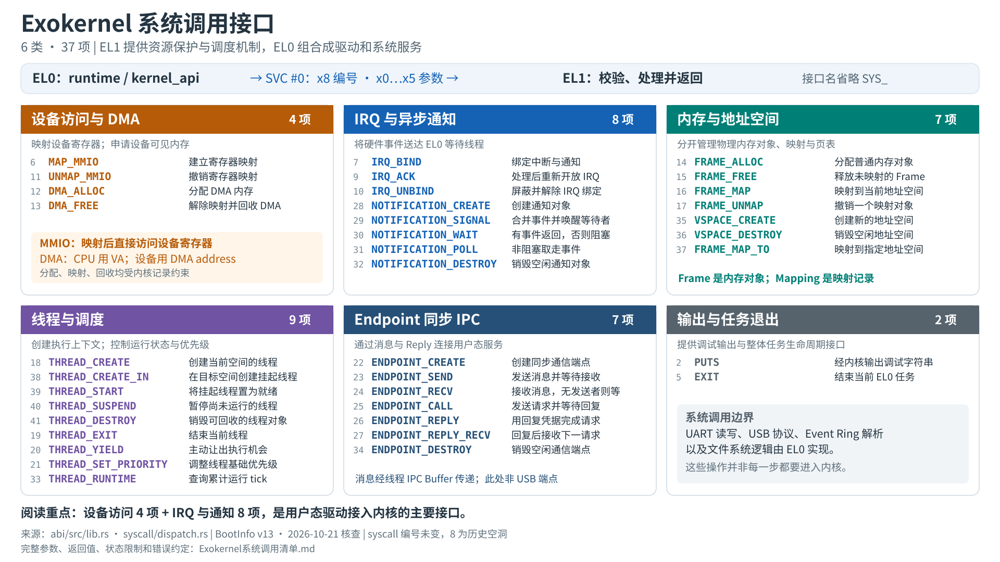

# Exokernel 系统调用接口清单

核查日期：2026-10-19。依据当前工作区实现；共 **37 个系统调用，分为 6 类**。本文只说明本系统已存在的接口，不包含 Linux 兼容层设想。



## 调用入口与记号

- EL0 通过 `runtime::svc/svc5/svc6` 设置 x8=调用编号、x0…x5=参数，再执行 `svc #0`；EL1 分发器处理，通常以 x0 返回结果。
- 下表参数按 x0、x1…顺序排列。VA 是 CPU 虚拟地址，PA 是物理地址；handle 是带对象身份的凭据，不能当指针或 fd。
- 页单位为 4 KiB；只有标为 bytes 的参数按字节计。Frame 映射权限目前为 R、RW、RX，不接受任意组合。
- 资源操作的校验依接口而异：MMIO/IRQ 对照授权记录，对象操作检查归属、generation 和状态；不能假定所有接口都采用同一种检查或错误编码。
- 系统调用全集来自 abi/src/lib.rs。编号 8 是历史空洞；SYS_ERR_* 是错误常量，不算接口。

## 分类索引

| 分类 | 数量 | 管什么 |
| --- | ---: | --- |
| 设备访问与 DMA | 4 | 映射设备寄存器；申请设备可见内存 |
| IRQ 与异步通知 | 8 | 将硬件事件送达 EL0 等待线程 |
| 内存与地址空间 | 7 | 分开管理物理内存对象、映射与页表 |
| 线程与调度 | 9 | 创建执行上下文；控制运行状态与优先级 |
| Endpoint 同步 IPC | 7 | 通过消息与 Reply 连接用户态服务 |
| 输出与任务退出 | 2 | 提供调试输出与整体任务生命周期接口 |

## 设备访问与 DMA（4 项）

映射设备寄存器；申请设备可见内存。

| 编号 / 接口 | 输入参数（x0 起） | 返回值 | 具体作用与约束 |
| --- | --- | --- | --- |
| 6 · `SYS_MAP_MMIO`<br>建立寄存器映射 | `PA, size_bytes, EL0_VA` | 0；失败为正整数状态码 | 验证设备授权、页对齐及 VA 冲突，建立 Device-nGnRE、EL0 可访问且不可执行的映射。size 向上取整到 4 KiB；映射后驱动直接 volatile 访问寄存器。 |
| 11 · `SYS_UNMAP_MMIO`<br>撤销寄存器映射 | `EL0_VA, size_bytes` | 0；失败为正整数状态码 | 按已登记的 VA 和取整后的长度撤销完整 MMIO 映射并刷新 TLB；不负责停止设备。 |
| 12 · `SYS_DMA_ALLOC`<br>分配 DMA 内存 | `size_bytes, alignment_bytes, EL0_VA` | DMA address；失败为 u64::MAX | 分配连续、清零的物理页并映射到指定 CPU VA，属性为 Normal Non-cacheable；当前无 IOMMU 路径返回 PA 作为设备 DMA 地址。alignment 必须为非零 2 的幂且不超过 2 MiB；VA 按 4 KiB 对齐。 |
| 13 · `SYS_DMA_FREE`<br>解除映射并回收 DMA | `EL0_VA, size_bytes` | 0；失败为正整数状态码 | 按当前任务的 VA+取整长度核对记录，撤销映射并释放物理页。调用者必须先确保设备不再访问该缓冲区。 |

## IRQ 与异步通知（8 项）

将硬件事件送达 EL0 等待线程。

| 编号 / 接口 | 输入参数（x0 起） | 返回值 | 具体作用与约束 |
| --- | --- | --- | --- |
| 7 · `SYS_IRQ_BIND`<br>绑定中断与通知 | `INTID, notification_handle, badge, target_cpu` | 0；失败为正整数或 SYS_ERR_* | 只允许获授权的 SPI；验证通知对象及非零 badge。配置 GIC 路由并开放 IRQ。target_cpu 可为 IRQ_TARGET_CURRENT；设备自身中断使能仍由 EL0 写寄存器。 |
| 9 · `SYS_IRQ_ACK`<br>处理后重新开放 IRQ | `INTID` | 0；失败为 1 | 确认当前绑定的中断处理完成，重新开放该 IRQ；不是设备寄存器清中断操作。EL1 收到 IRQ 时已先屏蔽并 EOI，EL0 必须先处理设备状态再 ACK。 |
| 10 · `SYS_IRQ_UNBIND`<br>屏蔽并解除 IRQ 绑定 | `INTID` | 0；失败为 1 | 解除当前任务的 IRQ 绑定，禁用相应中断；驱动应先完成设备侧停机和事件处理。 |
| 28 · `SYS_NOTIFICATION_CREATE`<br>创建通知对象 | `无` | NotificationHandle；失败为 SYS_ERR_* | 创建当前任务拥有的 pending badge 位图和等待队列；handle 不是地址。 |
| 29 · `SYS_NOTIFICATION_SIGNAL`<br>合并事件并唤醒等待者 | `notification_handle, badge` | 0；失败为 SYS_ERR_* | 将非零 badge 按位 OR 合并；有等待者时取走 pending 并唤醒一个等待线程。多次相同 bit 不累计次数，也不是广播。 |
| 30 · `SYS_NOTIFICATION_WAIT`<br>有事件返回，否则阻塞 | `notification_handle` | badge；失败为 SYS_ERR_* | 原子取走并清空 pending；为空时入队并阻塞当前线程，其他线程可运行。当前没有超时参数。 |
| 31 · `SYS_NOTIFICATION_POLL`<br>非阻塞取走事件 | `notification_handle` | badge；空为 SYS_ERR_WOULD_BLOCK | 立即检查并消费 pending；不阻塞。以 EL1 实现为准：无事件返回 WOULD_BLOCK；EL0 封装把它转换为 Err，不是 Ok(0)。 |
| 32 · `SYS_NOTIFICATION_DESTROY`<br>销毁空闲通知对象 | `notification_handle` | 0；失败为 SYS_ERR_* | 仍绑定 IRQ 或仍有等待线程时返回 BUSY；成功后旧 handle 失效。 |

## 内存与地址空间（7 项）

分开管理物理内存对象、映射与页表。

| 编号 / 接口 | 输入参数（x0 起） | 返回值 | 具体作用与约束 |
| --- | --- | --- | --- |
| 14 · `SYS_FRAME_ALLOC`<br>分配普通内存对象 | `pages, align_pages` | FrameHandle；失败为 SYS_ERR_* | 按页分配并清零，登记当前 owner。当前分配器也使用连续物理页，但本接口不返回 DMA address，也不建立设备可见性契约。申请后需另外 map。 |
| 15 · `SYS_FRAME_FREE`<br>释放未映射的 Frame | `frame_handle` | 0；失败为 SYS_ERR_* | 检查 owner、generation；仍有 Mapping 引用时返回 BUSY，必须先撤销全部关联映射。 |
| 16 · `SYS_FRAME_MAP`<br>映射到当前地址空间 | `frame_handle, offset_pages, pages, VA, rights` | MappingHandle；失败为 SYS_ERR_* | 把 Frame 指定页范围映射到当前 VSpace，检查范围、权限和地址冲突；普通内存采用相应 RO/RW/RX 缓存映射。 |
| 17 · `SYS_FRAME_UNMAP`<br>撤销一个映射对象 | `mapping_handle` | 0；失败为 SYS_ERR_* | 按 Mapping 记录撤销映射、更新引用和 TLB；不同时释放 Frame，也不是任意 VA 区间解除。 |
| 35 · `SYS_VSPACE_CREATE`<br>创建新的地址空间 | `无` | VSpaceHandle；失败为 SYS_ERR_* | 创建独立用户地址空间并登记管理关系；不复制应用、不装载 ELF、不自动启动线程。 |
| 36 · `SYS_VSPACE_DESTROY`<br>销毁空闲地址空间 | `vspace_handle` | 0；失败为 SYS_ERR_* | 仅允许授权管理者销毁无线程、无 Mapping 的 VSpace；仍有引用返回 BUSY，初始地址空间不允许这样销毁。 |
| 37 · `SYS_FRAME_MAP_TO`<br>映射到指定地址空间 | `frame_handle, vspace_handle, offset_pages, pages, VA, rights` | MappingHandle；失败为 SYS_ERR_* | 在授权目标 VSpace 建立映射，参数用到 x5。返回的目标 VA 属于目标空间，不保证在调用者当前空间可解引用。 |

## 线程与调度（9 项）

创建执行上下文；控制运行状态与优先级。

| 编号 / 接口 | 输入参数（x0 起） | 返回值 | 具体作用与约束 |
| --- | --- | --- | --- |
| 18 · `SYS_THREAD_CREATE`<br>创建当前空间的线程 | `entry, arg, cpu, priority, mcp` | ThreadHandle；失败为 SYS_ERR_* | 在当前 VSpace 创建线程，内核分配线程栈和 IPC Buffer，校验入口可执行并发布为 Ready；无需另调 START。 |
| 38 · `SYS_THREAD_CREATE_IN`<br>在目标空间创建挂起线程 | `vspace_handle, config_VA` | ThreadHandle；失败为 SYS_ERR_* | 从调用者空间复制 ThreadCreateConfig；校验目标入口与栈权限，创建 Suspended 线程。目标栈由调用者预先映射。 |
| 39 · `SYS_THREAD_START`<br>将挂起线程置为就绪 | `thread_handle` | 0；失败为 SYS_ERR_* | 将 Suspended 转为 Ready 并交给调度器；其他状态返回 BUSY，不保证调用后立刻获得 CPU。 |
| 40 · `SYS_THREAD_SUSPEND`<br>暂停尚未运行的线程 | `thread_handle` | 0；失败为 SYS_ERR_* | 当前实现只把 Ready 转为 Suspended；已 Suspended 也成功。Running/Blocked 等状态返回 BUSY，不能强停任意运行线程。 |
| 41 · `SYS_THREAD_DESTROY`<br>销毁可回收的线程对象 | `thread_handle` | 0；失败为 SYS_ERR_* | 拒绝 Running/Blocked；回收线程对象、自动 IPC Buffer 并解除 VSpace 线程引用。调用者配置的栈 Frame/Mapping 仍需单独管理。 |
| 19 · `SYS_THREAD_EXIT`<br>结束当前线程 | `exit_code` | 不返回到退出线程 | 取消 IPC 等待，回收该线程由内核拥有的栈/IPC Buffer，交给调度器；没有同 owner 的存活线程时走 task 退出路径。不是 pthread_join 接口。 |
| 20 · `SYS_THREAD_YIELD`<br>主动让出执行机会 | `无` | 恢复执行后返回 0 | 把当前执行机会交给调度器，线程仍可运行；不是 sleep，也不保证所有较低优先级线程都得到运行。 |
| 21 · `SYS_THREAD_SET_PRIORITY`<br>调整线程基础优先级 | `thread_handle, priority` | 0；失败为 SYS_ERR_* | 在授权范围内调整优先级。范围 0..63，数值越大优先级越高，受线程 mcp 限制。 |
| 33 · `SYS_THREAD_RUNTIME`<br>查询累计运行 tick | `thread_handle` | 运行 tick；失败为 SYS_ERR_* | 读取内核记账的 CPU 运行时间，不是墙上时钟，也不是睡眠接口。 |

## Endpoint 同步 IPC（7 项）

通过消息与 Reply 连接用户态服务。

| 编号 / 接口 | 输入参数（x0 起） | 返回值 | 具体作用与约束 |
| --- | --- | --- | --- |
| 22 · `SYS_ENDPOINT_CREATE`<br>创建同步通信端点 | `无` | EndpointHandle；失败为 SYS_ERR_* | 创建当前任务拥有的发送/接收会合端点。这里的 Endpoint 不是 USB endpoint。 |
| 23 · `SYS_ENDPOINT_SEND`<br>发送消息并等待接收 | `endpoint_handle` | 交付后 0；失败为 SYS_ERR_* | 消息来自当前线程 IPC Buffer；没有接收者时发送线程阻塞，有接收者时交付。不等待服务处理结果。 |
| 24 · `SYS_ENDPOINT_RECV`<br>接收消息，无发送者则等 | `endpoint_handle` | 接收后 0；失败为 SYS_ERR_* | 消息写入接收线程 IPC Buffer；没有发送者时阻塞。CALL 请求额外带 ReplyHandle。 |
| 25 · `SYS_ENDPOINT_CALL`<br>发送请求并等待回复 | `endpoint_handle` | 收到回复后 0；失败为 SYS_ERR_* | 请求来自 IPC Buffer；交付后调用者继续等待服务器 Reply。回复内容也放入调用者 IPC Buffer。 |
| 26 · `SYS_ENDPOINT_REPLY`<br>用回复凭据完成请求 | `reply_handle` | 0；失败为 SYS_ERR_* | 以当前线程 IPC Buffer 为回复内容，核对 Reply 归属与接收服务器线程；唤醒原调用者并消耗 ReplyHandle。 |
| 27 · `SYS_ENDPOINT_REPLY_RECV`<br>回复后接收下一请求 | `endpoint_handle, reply_handle` | 接收后 0；失败为 SYS_ERR_* | 在一次 syscall 中完成回复及后续接收；没有下一请求仍会阻塞。适合服务器循环。 |
| 34 · `SYS_ENDPOINT_DESTROY`<br>销毁空闲通信端点 | `endpoint_handle` | 0；失败为 SYS_ERR_* | 存在等待的发送/接收者或未完成 Call/Reply 时拒绝；成功后旧 handle 失效。 |

## 输出与任务退出（2 项）

提供调试输出与整体任务生命周期接口。

| 编号 / 接口 | 输入参数（x0 起） | 返回值 | 具体作用与约束 |
| --- | --- | --- | --- |
| 2 · `SYS_PUTS`<br>经内核输出调试字符串 | `string_VA, length_bytes` | 正常返回 0 | EL1 逐字节读取用户 VA 并写 UART。当前实现直接解引用，没有在此函数中做完整用户缓冲区检查；使用有效地址。libOS 接管 UART 后 puts 通常直接在 EL0 输出。 |
| 5 · `SYS_EXIT`<br>结束当前 EL0 任务 | `exit_code` | 不返回 | 进入 task::exit_current：停止其他 CPU 上的共享任务执行，清理 IRQ、线程、IPC、映射等资源并结束运行；不是单个用户进程的 POSIX exit。 |

## 容易混淆的边界

**Frame 与 DMA**：两者底层都使用内存页。Frame 面向 CPU 地址空间，返回对象 handle，再单独建立映射；DMA_ALLOC 直接组合物理分配与指定 VA 映射，返回设备地址。当前两者都可能连续，区别不能简单写成‘连续和不连续’。

**IRQ 与 Notification**：IRQ 是设备事件来源，Notification 是唤醒线程的内核对象；软件 SIGNAL 也能发送通知。典型顺序为硬件 IRQ → EL1 屏蔽并 EOI → 投递 badge → EL0 WAIT 返回 → 处理设备状态/Event Ring → IRQ_ACK 重新开放。

**Endpoint 与 Notification**：Endpoint 携带消息并提供同步会合/回复；Notification 合并事件位图，不传输任意 payload。IPC Buffer 是 48 字节的 IpcMessage，包含 label、4 个 u64 words 和 reply；大块数据需另行安排共享内存。

**Task、VSpace 与 Thread**：Task 是当前授权/资源管理上下文；VSpace 是地址空间；Thread 是执行上下文。创建 VSpace 不等于启动进程。ELF 装载由 EL0 ProcessBuilder 组合 Frame、VSpace、Thread 完成。

**这些是用户态普通操作，不是新增 syscall**：UART read_word/write_word/set_interrupt_masks；xHCI 寄存器编程和 Event Ring 解析；Rust poll/await；runtime::delay_ns 的计数器忙等；ext4 路径和文件解析。

## 返回值与当前实现差异

当前 ABI 没有统一成一种错误返回约定，使用时必须按接口处理：

| 接口范围 | 错误约定 |
| --- | --- |
| Frame / VSpace / Thread / Endpoint / Notification 对象操作 | SYS_ERR_*；封装通常通过 is_sys_error 检查 |
| MAP_MMIO / UNMAP_MMIO / DMA_FREE | 0 成功；正整数表示不同错误 |
| IRQ_BIND | 0 成功；既可能返回正整数，也可能返回 SYS_ERR_INVALID |
| IRQ_ACK / IRQ_UNBIND | 0 成功；1 失败 |
| DMA_ALLOC | 成功返回 DMA address；u64::MAX 失败 |
| 未识别的 syscall 编号 | 当前返回 u64::MAX |

| 通用错误名 | u64 编码 | 含义 |
| --- | --- | --- |
| INVALID | MAX | 参数或请求无效 |
| NO_MEMORY | MAX−1 | 内存不足 |
| NO_SLOT | MAX−2 | 对象槽位不足 |
| DENIED | MAX−3 | 授权/权限不满足 |
| BUSY | MAX−4 | 当前状态或引用关系不允许操作 |
| CONFLICT | MAX−5 | 映射等状态冲突 |
| NOT_FOUND | MAX−6 | 对象不存在、失效或无法由当前调用者解析 |
| WOULD_BLOCK | MAX−7 | 非阻塞检查当前没有可消费事件 |

本次发现的文档/封装差异：Notification::poll 的注释说空时返回 0，但 EL1 实际返回 WOULD_BLOCK，封装返回 Err；runtime::irq_ack 丢弃底层返回值，清单中的返回值指原生 syscall。Frame::free 的旧注释容易让人误以为自动回收映射，EL1 实际在仍有映射时返回 BUSY。此处记录实现事实，未修改源码。

## 常见使用顺序

```text
UART：MAP_MMIO → NOTIFICATION_CREATE → IRQ_BIND
      → EL0 打开设备中断 → WAIT → EL0 寄存器读写/清状态 → IRQ_ACK

DMA：DMA_ALLOC → EL0 写描述符/缓冲区 → 设备使用
     → 确认设备不再访问 → DMA_FREE

普通内存：FRAME_ALLOC → FRAME_MAP → CPU 访问 → FRAME_UNMAP → FRAME_FREE

新地址空间：VSPACE_CREATE → 映射 ELF/栈 → THREAD_CREATE_IN → THREAD_START
            → 线程结束/销毁 → 解除映射/释放 Frame → VSPACE_DESTROY

同步服务：ENDPOINT_CREATE → 客户端 CALL ↔ 服务端 RECV/REPLY_RECV
```

## 源码定位

| 层次 | 文件 |
| --- | --- |
| 编号、句柄、配置结构 | [abi/src/lib.rs](../abi/src/lib.rs) |
| EL0 SVC、MMIO/DMA/IRQ 封装 | [runtime/mod.rs](../libos/src/runtime/mod.rs) |
| EL0 对象封装 | [kernel_api](../libos/src/kernel_api/mod.rs) |
| EL1 分发、MMIO/DMA/IRQ 实现 | [syscall/dispatch.rs](../kernel/src/syscall/dispatch.rs) |
| Frame / VSpace | [frame.rs](../kernel/src/memory/frame.rs)、[vspace.rs](../kernel/src/memory/vspace.rs) |
| Thread / IPC / Task | [thread.rs](../kernel/src/object/thread.rs)、[ipc.rs](../kernel/src/object/ipc.rs)、[task.rs](../kernel/src/object/task.rs) |

图和本清单由 [generate_exokernel_reference.py](兼容性研究/generate_exokernel_reference.py) 的同一份数据生成。脚本核对 37 个名称和编号与 ABI 定义一致；参数、返回和行为依据内核实现人工核查。
