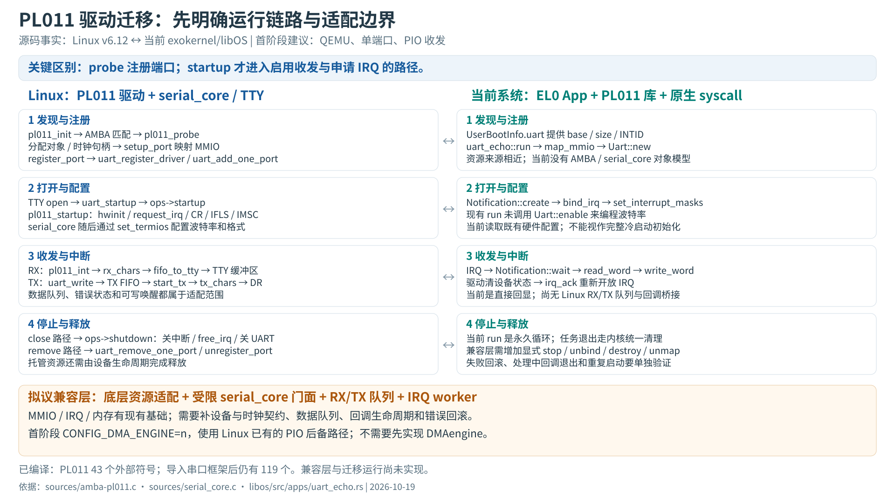

# Linux PL011 迁移：运行链路、依赖与第一阶段方案

核查日期：2026-10-19。源端固定 Linux **v6.12**，目标端依据当前 exokernel 工作区。本文区分已核实源码事实、建议实现和仍待构建验证的部分。

**建议第一实验使用 QEMU 的一个 PL011，以 Linux 已有的 PIO 路径验证用户态驱动环境。** 保留寄存器收发和 IRQ 处理逻辑，在外部提供设备资源、受限串口框架、队列和回调适配。先做编译依赖验证，再实现后端。暂不能承诺把原文件直接加入 Cargo 就能运行。



## 本次实际完成了什么

- 下载并固定 5 份 Linux v6.12 源文件，约 270 KiB；保留原始内容和许可证注释，来源及 SHA-256 在 [sources-manifest.json](sources-manifest.json)。
- 人工核对发现/注册、打开/启动、波特率配置、RX/TX、中断、关闭和移除链路。
- 对 **52 个代表依赖接口**建立调用位置及适配建议：[依赖索引](关键依赖索引.md)、[CSV](关键依赖对照.csv)。这不是完整编译依赖闭包，未做宏展开、间接回调或链接验证。
- 对照当前 [uart_echo.rs](../../../libos/src/apps/uart_echo.rs) 和 [PL011 库](../../../libos/vendor/arm-pl011-uart/src/lib.rs)，确定已有基础及缺口。

**后续进展：已完成完整源码准备、有效 `.config`、PL011 及串口框架对象编译。** 实际 PL011 为 43 个外部符号，组合串口框架后仍有 119 个；详见 [编译结果与兼容层缺口](编译结果与兼容层缺口.md) 及 [完整符号对照](compiled/symbol-boundaries.csv)。下面的 52 项代表索引保留为源码分析记录；兼容后端及运行验收尚未完成。

## 1. Linux 原驱动究竟怎么运行

### 注册端口不等于启动收发

```text
arch_initcall(pl011_init)
  → 注册 AMBA 驱动，另有 SBSA platform 分支
  → 设备匹配 AMBA ID
  → pl011_probe
       → devm_kzalloc 分配 uart_amba_port
       → devm_clk_get 获取时钟对象
       → 设置 vendor / iotype / IRQ / uart_ops
       → pl011_setup_port
            → devm_ioremap_resource 映射寄存器
            → 获取串口模式等信息
       → pl011_register_port
            → 屏蔽并清理 UART 设备中断
            → 必要时 uart_register_driver
            → uart_add_one_port
```

这些操作建立端口与框架的关系。正常 TTY 使用还要经过打开路径，才进入驱动的 `startup`。AMBA 匹配规则、端口 ops 和入口都可在 [amba-pl011.c](sources/amba-pl011.c) 中查看。

```text
TTY 打开串口
  → uart_open / tty_port_open
  → uart_port_activate
  → uart_startup → uart_port_startup
       → 分配发送队列
       → uport->ops->startup = pl011_startup
            → pl011_hwinit：引脚状态、时钟、清状态
            → pl011_allocate_irq：request_irq(pl011_int, IRQF_SHARED, uap)
            → IFLS / CR 等寄存器设置
            → pl011_dma_startup（无 DMA 配置时是上游空分支）
            → pl011_enable_interrupts：排空旧数据并配置接收中断
       → uart_change_line_settings
            → ops->set_termios = pl011_set_termios
            → 波特率分频、LCRH、状态掩码等
```

打开与回调的连接依据 [serial_core.c](sources/serial_core.c) 的 `uart_port_activate`、`uart_port_startup`；不能把 probe、startup、set_termios 合并成一个没有先后关系的“init”。

### RX 与 TX 的数据经过框架队列

RX：

```text
Linux IRQ 子系统调用 pl011_int(irq, uap)
  → 读取 RIS & uap->im，判断中断原因
  → pl011_rx_chars
       → pl011_fifo_to_tty
            → FR 判断 FIFO；DR 取字节与错误位
            → 错误计数 / read_status_mask / SysRq 等处理
            → uart_insert_char 插入接收数据
       → tty_flip_buffer_push 交给上层消费
```

上层 `read()` 最终通过 TTY 接收缓冲、行规程等取得数据，不是 PL011 的中断函数直接返回给 `read()`。本次未逐层分析 TTY/行规程实现，因此不把完整 Linux read 路径画成已核实调用图。

TX：

```text
TTY 输出进入 serial_core::uart_write
  → kfifo_in 写入 xmit_fifo
  → __uart_start
       → 运行时电源状态检查
       → port->ops->start_tx = pl011_start_tx
       → 无 DMA 时进入 PIO 发送路径
       → pl011_tx_chars / pl011_tx_char → DR
  → 没有发完则保留 TX 中断，后续 IRQ 继续发送
  → 队列腾出空间时 uart_write_wakeup 通知可写
```

因此不能只让 `uart_write_wakeup()` 返回，也不能让 `uart_insert_char()` 丢数据：兼容门面必须维护队列及唤醒条件。

### 关闭和移除是不同阶段

- 正常关闭的框架路径会调用 `ops->shutdown`。PL011 关闭设备中断、停止 DMA、`free_irq`、禁用 UART，并处理时钟/引脚等状态。
- 设备移除走 `pl011_remove`，调用 `uart_remove_one_port` 和 `pl011_unregister_port`；托管资源由设备生命周期另行管理。
- 错误退出不是直接跳到 free：必须先排除仍在执行的回调及设备访问，再释放资源。

## 2. 与你当前实现的关键差别

| 项目 | 当前已存在的事实 | 迁移时需要做的事 |
| --- | --- | --- |
| 资源入口 | EL0 解析完整 DTB，DeviceInfo.uart 保存 PA、长度、GIC INTID；内核独立检查授权 | 为 Linux 设备门面构造 resource、IRQ 与私有数据；不能伪造任意设备授权 |
| 寄存器映射 | map_mmio 后，Uart 对象持有 UART_VA | 兼容 devm_ioremap_resource 的成功、失败及回收约定 |
| 初始化 | Uart::new 只保存寄存器指针；当前 run 没调用 enable | 明确继承配置还是冷启动配置；记录时钟、波特率、FIFO 和格式的来源 |
| 访问宽度 | Rust 库使用其定义的寄存器类型 | Linux pl011_read/write 根据 iotype 使用 16 或 32 位 relaxed 访问；不能统一替换为任意 32 位操作 |
| IRQ | Notification + bind + wait；处理后 ACK | 保存 Linux handler/dev_id，建立 EL0 IRQ 分发；处理完成、设备状态满足要求后再 ACK |
| 收发模型 | 当前循环从 FIFO 读字节并直接回写 | 提供 RX 队列、TX FIFO、错误状态、数据消费与可写条件 |
| 并发 | App 主要在单线程内使用 Uart | 定义 Linux 回调的串行执行模型和队列同步，不能把 irqsave 变成空函数 |
| 退出 | 永久 echo 循环，task 退出统一清理 | 增加独立 stop、回调停机、IRQ 解绑、通知销毁、MMIO 解除及失败回滚 |
| 日志 | EL1/EL0 调试输出与 echo 可能共用 UART | 明确测试期间谁拥有配置和 TX；避免内核日志污染字节比较或与重配置并发 |

当前 [kernel UART init](../../../kernel/src/drivers/uart.rs) 也主要记录基址，并不编程波特率。**现有回显能工作，说明该次启动已有可用配置；不能据此证明从未知寄存器状态冷启动已经完整实现。**

## 3. 代表依赖怎样处理

| 类别 | Linux 接口示例 | 现有可用基础 | 首阶段建议 |
| --- | --- | --- | --- |
| 普通内存 | devm_kzalloc | EL0 allocator | 清零分配，加设备资源账本；申请失败必须回滚 |
| MMIO | devm_ioremap_resource、readw/readl_relaxed | MAP_MMIO/UNMAP_MMIO | 适配授权映射；保留宽度、volatile 与顺序语义 |
| IRQ | request_irq/free_irq | Notification、IRQ_BIND/ACK/UNBIND | 注册回调、单端口分发、等待回调退出；支持范围记录为单一获授权处理者 |
| 锁与上下文 | uart_port_lock_irqsave 等 | 原子/锁、线程调度 | 采用单 UART worker 串行运行驱动回调；前台通过队列提交操作 |
| serial_core | uart_register_driver/add_one_port 等 | 当前没有 Linux 框架 | 先做受限门面，真实建立对象、队列和回调连接；保留完整导入作为后续路线 |
| RX 上送 | uart_insert_char、tty_flip_buffer_push | 当前直接 echo | bridge 到本地 RX 字节/状态队列；不声称提供 TTY 行规程 |
| TX 缓冲 | kfifo_*、uart_write_wakeup | 可实现 EL0 内存队列 | 优先复用合适的算法；明确定义背压、短写及唤醒条件 |
| 时钟 | devm_clk_get、clk_get_rate/prepare_enable | BootInfo UART 仅资源位置 | QEMU 明确频率及固定时钟契约；不能把 clk_get_rate 随意返回常数 |
| 引脚 | pinctrl_* | 当前依赖平台已具备配置 | QEMU 可声明无 pinmux 操作；Pi5 后续单独核查 |
| 配置 | uart_get_baud_rate、uart_update_timeout | 库提供 enable，但 App 未使用 | 固定 8N1、无硬件流控，真实编程/读取验证分频及格式 |
| DMA/DMAengine | dma_alloc_coherent、dma_request_chan 等 | DMA_ALLOC 仅是内存基础 | 选上游 CONFIG_DMA_ENGINE=n 的 PIO 后备路径；后续 DMA 通道框架另议 |
| 其他功能 | console、SysRq、modem、RS485、PM | 没有完整对应框架 | 从实验行为范围排除；编译排除与运行时禁用必须分别说明 |

**限制有两层：**

1. `CONFIG_DMA_ENGINE=n` 确实使驱动选入已有无 DMA 分支，相关实现可查源文件的 `#else`。
2. RS485 不启用、固定 8N1 等运行约束，不等于相关函数自动从目标文件消失。必须检查预处理、函数指针表和链接引用，再决定保留实现、修改编译范围或显式报不支持。禁止活跃路径“返回成功但什么也没做”。

Kconfig 还明确 `SERIAL_AMBA_PL011` 依赖 `ARM_AMBA` 并选择 `SERIAL_CORE`。只关闭 DMA 不会删除串口框架。[Kconfig 快照](sources/Kconfig)

## 4. 第一版实现形态：保留 C，使用小范围驱动环境

建议结构（尚未创建这些源码模块）：

```text
Rust 实验 App
  → 测试控制接口：启动 / 写入 / 读取 / 停止
  → 前台 RX/TX 请求队列
  → 单 UART worker
       → Linux C PL011 的选定回调
       → 受限 serial_core/TTY 门面：状态、FIFO、字节与错误事件
       → exokernel 后端：MMIO / IRQ / 内存 / 固定平台时钟
            → 原生 syscall 与映射后的寄存器访问
```

阶段目标是尽量保留 Linux PL011 原始实现，通过构建和门面满足选定路径。若最终必须抽出函数、删改原文件，就记录补丁，并称为 **PL011 功能子集迁移**；不能称为完整无修改驱动兼容。

拟议目录边界：

| 位置 | 职责 |
| --- | --- |
| 独立 Linux C 实验库 | 固定源码、头文件、配置与补丁；编译为 AArch64 freestanding 静态库 |
| libos/src/compat/linux_driver/ | C ABI 资源后端、设备门面、IRQ 注册及模式限制；不要修改现有 vendor 统一接口 |
| libos/src/apps/linux_uart_smoke.rs | 单设备实验和验收控制，不承担驱动寄存器算法 |
| runtime / kernel_api | 复用原生 syscall 和对象封装；是否新增原语由已确认的缺口决定 |

C/Rust 之间只通过明确的 C ABI 结构与函数连接；不把 Rust 的 Uart/Notification 内部布局暴露给 C，不让 C unwind 越过 FFI。C 编译环境和 Linux 头文件集必须先实际建立，不能仅手写一个名字相同的头文件就认定结构兼容。

### 一个 IRQ 的拟议时序

```text
设备 IRQ → EL1 屏蔽/EOI → Notification badge
  → UART worker 被唤醒
  → 调用已注册 pl011_int(irq, dev_id)
  → RX 入队 / TX 出队，记录错误与待唤醒客户端
  → 确认设备处理状态，执行 IRQ_ACK
  → 客户端读取队列或继续等待
```

源端始终使用 `IRQF_SHARED` 注册。首实验可以限定物理 IRQ 只有本驱动一个获授权处理者，但门面必须保存这个限制并处理重复注册；不能把它宣传成支持任意共享 IRQ 链。软件 Linux IRQ 号与 GIC INTID 应有显式映射，即使第一版数值恰好相同。

### 为什么用单 worker

把驱动入口和设备回调集中到一个线程，便于先保证互不重入；前台请求只进队列，不直接在其他 CPU 操作驱动状态。Notification 仅提示有事件，数据及计数由队列保存。

这只是本实验的目标执行模型。仍需处理驱动调用中的 unlock/relock、同步调用递归、排队期间的唤醒以及停止请求；不能据此把所有锁实现为空，也不能声称满足任意 Linux 中断上下文代码。

## 5. 执行步骤与每步停止条件

### A. 建立源端编译证据

准备独立的完整 Linux v6.12 构建树和 AArch64 工具链，放在仓库外缓存。生成真实 `.config` 与头文件，取得原驱动的编译命令、预处理文件和目标文件。

配置意图：PL011、AMBA、SERIAL_CORE 需要启用；DMA_ENGINE、PL011_CONSOLE、CONSOLE_POLL、PM_SLEEP、ACPI 等按最小目标关闭，并让 Kconfig 解析有效组合。**这一步现已完成，实际有效配置见 [linux.config](compiled/linux.config)，编译验证使用 SMP=y、4 CPU 配置。**

检查函数指针表及内联宏后的依赖；用 nm/readelf 辅助查看外部符号，但不能仅凭 nm 判断全部语义。报告每个缺口：导入、实现、受配置排除、明确不支持。

完成标准：有可复现的原驱动构建命令、`.config` 哈希、真实符号清单和未解析项，不掩盖链接失败。

### B. 先让门面可编译、可链接

建立设备对象、uart_port/state、RX/TX FIFO、错误计数、IRQ 注册表和时钟配置。优先接通 alloc/ioremap/寄存器访问与 IRQ，再接 startup/set_termios 和数据桥接。

上游原文件与适配补丁分开保存；若依赖快速扩大，比较“继续导入 serial_core”与“受限门面”的实际工作量，再决定范围，不持续堆砌假成功桩。

完成标准：目标静态库和 Rust App 链接成功；活跃入口不存在未实现路径；映射失败、分配失败均有明确回滚。

### C. QEMU 上验证 PIO 和中断链路

先检查配置和 MMIO 宽度，再验证 TX，之后验证 RX IRQ、短读/背压、空闲阻塞及停止。host 使用明确 raw 模式注入字节，避免终端本地回显造成假成功。测试日志和数据区分，避免多个输出源争用 UART。

验收建议：

| 情况 | 应得到的结果 |
| --- | --- |
| 无输入等待 | worker 阻塞，其他线程可运行；没有永久忙等 |
| 小包与超过 FIFO 的突发输入 | 在定义负载内按序传递，无重复或静默丢失；错误有计数 |
| 0x00/0x0a/0x0d/0xff 等二进制数据 | raw 路径按原字节传输，不被终端转换或日志污染 |
| TX FIFO 满 / 软件队列满 | 明确背压或短写；后续可写时正确唤醒 |
| 输入先于 wait、通知合并 | 队列状态保证数据不依赖事件次数，无丢唤醒 |
| 未授权地址、绑定失败、内存不足 | 返回错误、回滚资源；不能继续使用无效地址 |
| 连续启动/停止 | 队列、回调、IRQ、通知与映射按顺序释放；旧 handle 不复用 |
| FIFO 溢出或硬件错误 | 记录并传播约定状态；不能宣称接收永不丢字节 |

现有 `qemu/run.sh` 支持 `LIBOS_APP=uart-echo`，但它运行的是 Rust 基准实现。Linux 实验必须有自己的 App 标识与构建路径，不能把原 echo 测试通过当作迁移通过。

## 6. 与 IR 研究怎样衔接

给 IR 同学的第一输入可选 `pl011_read/write`、PIO 收发函数和 `pl011_int`，保留源位置及调用条件；先识别 MMIO 访问宽度、中断原因与清除、FIFO 操作、计数和失败路径。

第一版 IR 输出是语义标注与未支持依赖清单。后端以已经手工验证的资源门面为基础；源端 TTY 上送与目标端队列之间的语义变化必须记录。有限测试的一致不等于完整 Linux 驱动等价证明。

## 原始资料

- [Linux v6.12 amba-pl011.c](https://github.com/torvalds/linux/blob/v6.12/drivers/tty/serial/amba-pl011.c)
- [Linux v6.12 serial_core.c](https://github.com/torvalds/linux/blob/v6.12/drivers/tty/serial/serial_core.c)
- [Low Level Serial API](https://docs.kernel.org/6.12/driver-api/serial/driver.html)
- 本地快照来自 kernel.googlesource.com 上游镜像同一 tag，详见 manifest；没有修改下载源码。

阶段 A 已完成。下一轮执行 B：根据真实 43 项外部符号、内联汇编、回调和结构布局设计目标头环境及最小资源门面，然后接通启动、IRQ 和 RX/TX 队列。不能直接把带 DAIF 关中断指令的 Linux .o 链接进 EL0。
